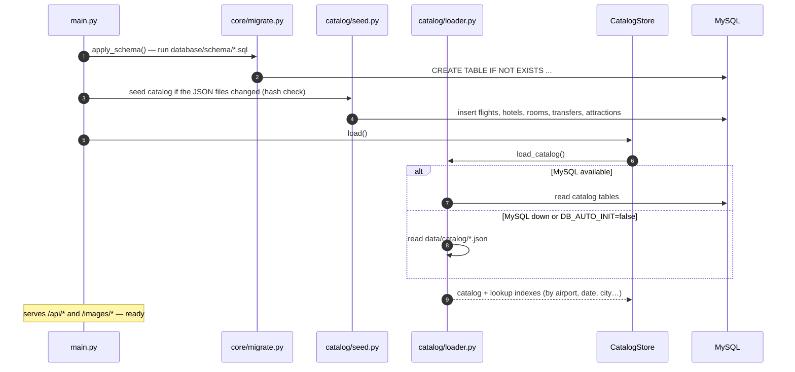
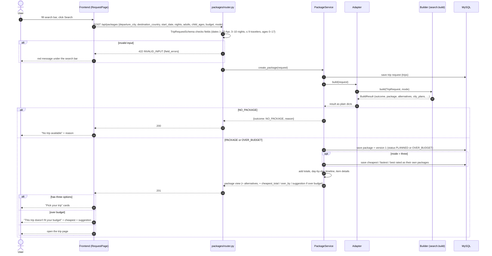
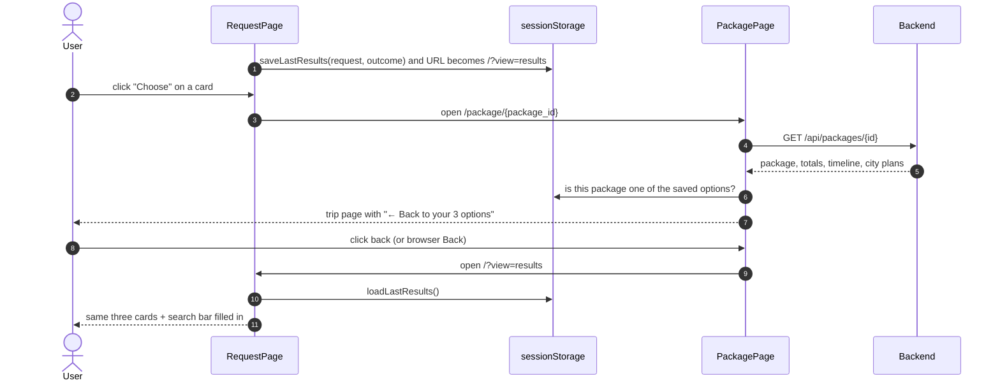
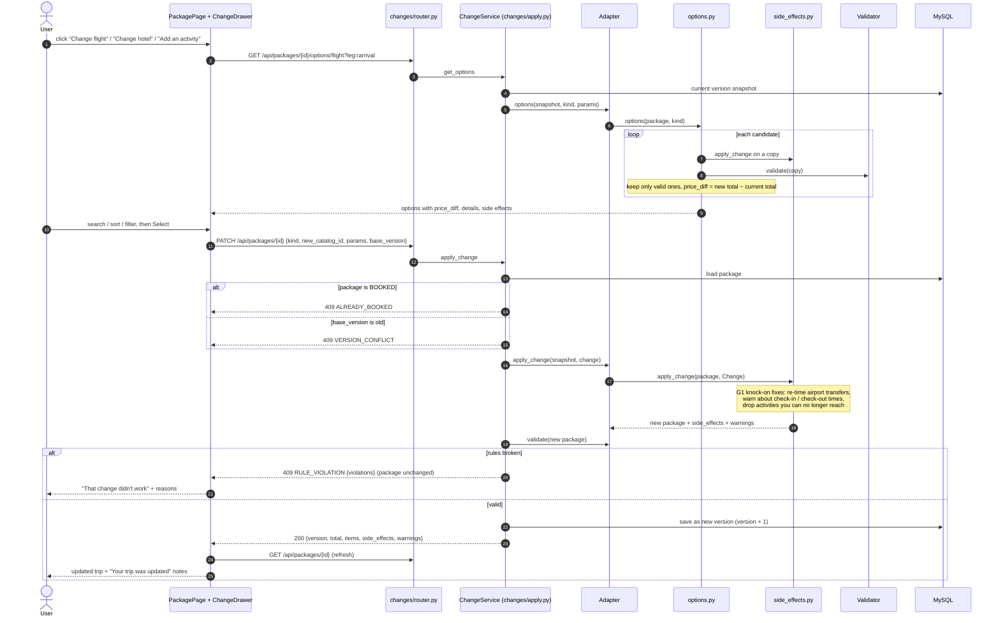
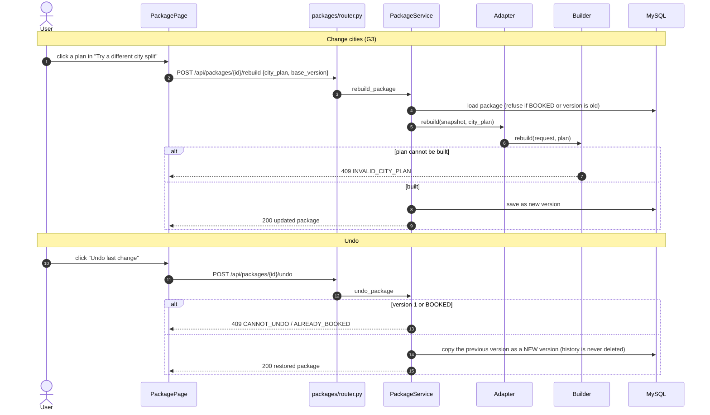
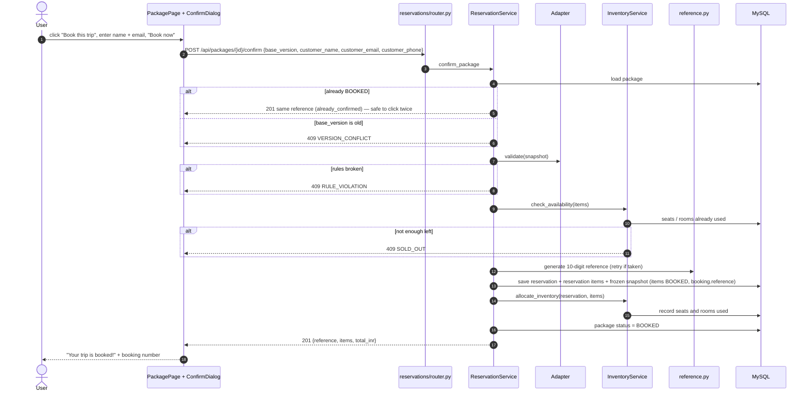
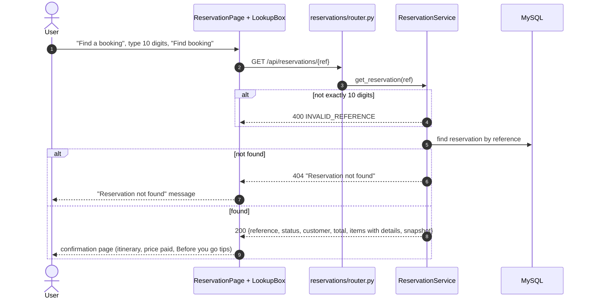
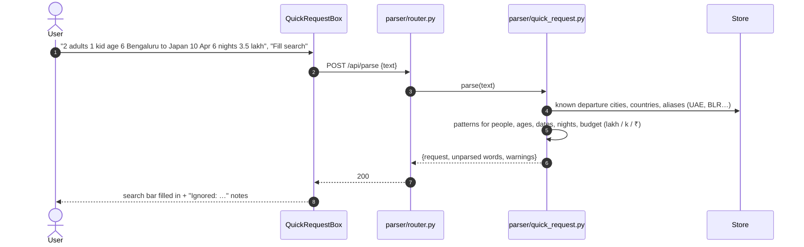
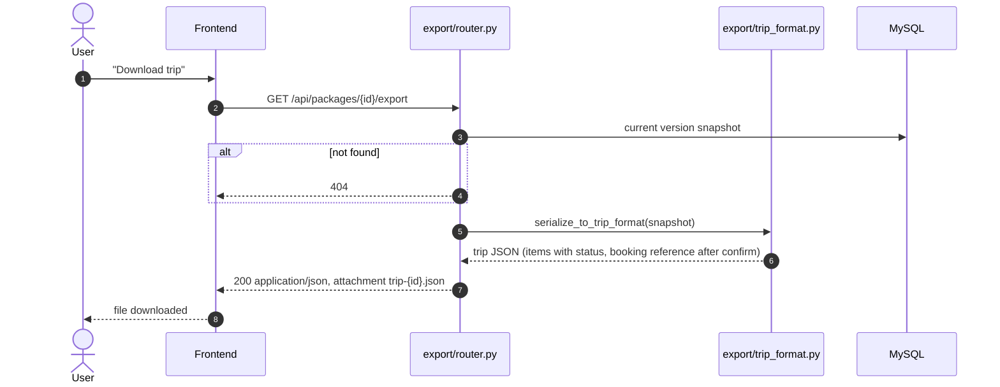

# Build My Holiday — Sequence Diagrams

How a request moves through the app, step by step. The diagrams use [Mermaid](https://mermaid.js.org/), which GitHub and VS Code (with a Mermaid preview extension) draw automatically.

**Who's who in the diagrams**

| Name | What it is | Code |
|---|---|---|
| User | The traveler in the browser | — |
| Frontend | React app (Vite dev server proxies `/api` to the backend) | `frontend/src` |
| Router | FastAPI endpoint | `backend/app/*/router.py` |
| Service | Business logic for one feature | `backend/app/*/service.py`, `changes/apply.py` |
| Adapter | The only bridge from API JSON to the engine | `backend/app/core/engine_adapter.py` |
| Builder | Builds packages | `backend/app/builder/` |
| Changes | Options and change side effects | `backend/app/changes/options.py`, `side_effects.py` |
| Validator | Checks every travel rule | `backend/app/rules/` |
| Store | In-memory catalog | `backend/app/catalog/store.py` |
| Inventory | Seats and rooms already booked | `backend/app/inventory/` |
| DB | MySQL | `backend/app/models/`, repositories |

**Contents**

1. [App startup](#1-app-startup)
2. [Search and build a package](#2-search-and-build-a-package)
3. [Inside the builder: how one package is formed](#3-inside-the-builder-how-one-package-is-formed)
4. [Pick one of the three options (G4)](#4-pick-one-of-the-three-options-g4)
5. [See alternatives and change part of the trip](#5-see-alternatives-and-change-part-of-the-trip)
6. [Change cities, and undo](#6-change-cities-and-undo)
7. [Book the trip](#7-book-the-trip)
8. [Find a booking by its number](#8-find-a-booking-by-its-number)
9. [Quick request (one line of text)](#9-quick-request-one-line-of-text)
10. [Download the trip](#10-download-the-trip)

---

## 1. App startup

The catalog is loaded once into memory, so building a package never waits on the database.



---

## 2. Search and build a package

`POST /api/packages`. With "Compare 3 options" ticked, the frontend sends `mode: "three"`.



---

## 3. Inside the builder: how one package is formed

`builder/search.py` → `build()`. Every city plan is built the same way, then the best is chosen.

```mermaid
sequenceDiagram
    autonumber
    participant B as search.build()
    participant St as Store
    participant CP as city_plans.py
    participant H as hotels.py
    participant T as transfers.py
    participant AT as attractions.py
    participant AS as assemble.py
    participant V as Validator
    participant SEL as selector.py
    participant ALT as alternatives.py

    B->>St: home airport, country, flights landing on start day / leaving on last day (enough seats)
    alt no flight either way
        B-->>B: NO_PACKAGE with the reason
    end
    B->>CP: enumerate_plans(cities, nights, min 2 per city, linked cities)
    CP-->>B: every order × every night split (Menon: 27 plans)
    loop each city plan
        B->>H: stay_options(city, check-in, nights) — fits family, rooms free every night, cheapest first (cached)
        B->>T: arrival_options: pickup = landing + 60 min
        B->>T: return_options: leave hotel = take-off − 180 min − drive time
        Note over B: cheapest (flight + transfer + hotel) chosen for each end separately
        B->>T: intercity_options: first slot ≥ 10:00 on the move day
        B->>AT: schedule(): one open activity per full day (Kuhn matching, no repeats)
        B->>AS: assemble(parts) → Package (items in time order)
        B->>V: validate(package)
        alt any rule broken
            V-->>B: violations → drop this plan, remember why
        else valid
            V-->>B: [] → keep as candidate
        end
    end
    B->>SEL: choose(candidates): city rule c* = max(1, nights ÷ 3), cheapest within budget, trying c*, c*−1…1, then c*+1
    alt one fits the budget
        SEL-->>B: PACKAGE
    else none fits
        SEL-->>B: OVER_BUDGET (cheapest + how much over + suggestion)
    end
    opt mode = three
        B->>ALT: three(candidates, budget)
        ALT-->>B: cheapest, fastest (shortest flights), best rated (most stars within budget)
    end
```

---

## 4. Pick one of the three options (G4)

The three options are already saved, so choosing one just opens it. The results are remembered in the browser tab for the back link.



---

## 5. See alternatives and change part of the trip

Options come from `GET …/options/{hotel|flight|attraction}`. The change is `PATCH /api/packages/{id}`.



---

## 6. Change cities, and undo



---

## 7. Book the trip

`POST /api/packages/{id}/confirm`. Seats and rooms are checked and reserved here (S2).



---

## 8. Find a booking by its number

`GET /api/reservations/{ref}`. Works after a backend restart, because it's read from MySQL.



---

## 9. Quick request (one line of text)

`POST /api/parse` (S1). Rules only, no AI.



---

## 10. Download the trip

`GET /api/packages/{id}/export` (M5) — the shared trip format from `data/DATA_DICTIONARY.md`.


